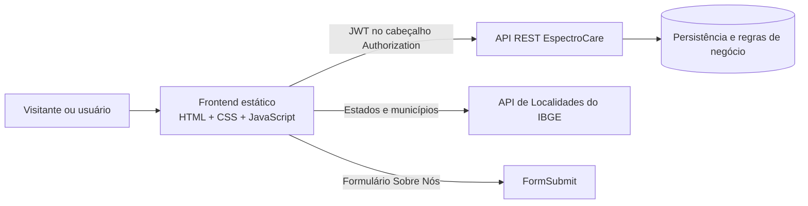

<div align="center">
  

  # EspectroCare

  **Acolhimento, informação e conexão para famílias, profissionais e pessoas que convivem com o Transtorno do Espectro Autista (TEA).**

  [](https://developer.mozilla.org/docs/Web/HTML)
  [](https://developer.mozilla.org/docs/Web/CSS)
  [](https://developer.mozilla.org/docs/Web/JavaScript)
  [](https://playwright.dev/)
  [](https://github.com/kaykekkj/Espectro-Care/commits/main)
  [](#status-do-projeto)
</div>

<p align="center">
  
</p>

## Sumário

- [Sobre o projeto](#sobre-o-projeto)
- [Funcionalidades](#funcionalidades)
- [Perfis de acesso](#perfis-de-acesso)
- [Arquitetura](#arquitetura)
- [Tecnologias e serviços](#tecnologias-e-serviços)
- [Estrutura do projeto](#estrutura-do-projeto)
- [Como executar](#como-executar)
- [Configuração da API](#configuração-da-api)
- [Páginas principais](#páginas-principais)
- [Testes](#testes)
- [Segurança e privacidade](#segurança-e-privacidade)
- [Como contribuir](#como-contribuir)
- [Equipe](#equipe)
- [Documentação complementar](#documentação-complementar)
- [Status e limitações](#status-e-limitações)
- [Licença](#licença)

## Sobre o projeto

A **EspectroCare** é uma plataforma web que aproxima famílias de profissionais, reúne conteúdos educativos sobre TEA e oferece recursos de acompanhamento de conta e perfil.

Este repositório contém o **frontend estático** da aplicação. A interface é construída com HTML, CSS e JavaScript sem framework ou etapa de build. Os dados dinâmicos são consumidos de uma API REST externa.

### Objetivos

- facilitar a descoberta de profissionais cadastrados;
- oferecer conteúdo educativo confiável e acessível;
- apoiar responsáveis e profissionais durante sua jornada;
- manter experiências separadas para responsáveis, profissionais e administradores;
- funcionar em desktop, tablet e celular.

> A EspectroCare é uma ferramenta informativa e de conexão. Ela não substitui avaliação, diagnóstico, tratamento ou orientação de profissionais habilitados.

## Funcionalidades

| Área | Recursos |
| --- | --- |
| Home | apresentação da plataforma, acesso rápido às áreas profissionais, artigos recentes e conteúdo adaptado à sessão do usuário |
| Profissionais | listagem, pesquisa, filtro por área de formação, perfil detalhado, foto e situação de conferência do CRM |
| Aprendizagem | listagem e leitura de artigos, imagens de capa, resumo, referências e recomendações |
| Contas | cadastro de responsável ou profissional, confirmação de e-mail, login, logout e recuperação de senha |
| Perfil | consulta e edição de dados, foto de perfil e informações específicas de cada tipo de conta |
| CRM | solicitação gratuita de conferência manual e apresentação clara do estado da análise |
| Administração | convites administrativos, publicação/edição de artigos e revisão de solicitações de CRM |
| Sobre nós | missão, história, equipe, carrossel de integrantes e formulário de contato |
| Responsividade | navegação móvel, layouts adaptáveis e verificações automatizadas de overflow |
| Acessibilidade | textos alternativos, regiões e mensagens com ARIA, foco visível e suporte a redução de movimento |

## Perfis de acesso

| Perfil | Principais permissões |
| --- | --- |
| Visitante | visualizar a Home e listagens públicas; ações protegidas direcionam para o login |
| Responsável | acessar a área da conta, editar dados e foto e consultar conteúdos protegidos |
| Profissional | manter perfil profissional, formação e conselho, solicitar conferência de CRM e aparecer na listagem |
| Administrador | gerenciar convites, artigos educativos e solicitações de conferência de CRM |

O frontend aplica proteções de navegação e exibição, mas a autorização definitiva deve ser validada pelo backend em todas as operações protegidas.

## Arquitetura



### Integração com a API

- URL padrão configurada em `assets/js/api-config.js`;
- requisições autenticadas centralizadas em `assets/js/auth.js`;
- token JWT enviado como `Authorization: Bearer <token>`;
- respostas `401` limpam a sessão e direcionam o usuário ao login quando necessário;
- páginas protegidas usam guardas de autenticação e preservam o destino original;
- a API pode ser substituída localmente sem alterar os arquivos do projeto.

O backend relacionado ao projeto está documentado em [`DiegodsGuinazu/BackEnd_TCC_3DS`](https://github.com/DiegodsGuinazu/BackEnd_TCC_3DS).

## Tecnologias e serviços

### Frontend

- HTML5 semântico;
- CSS3 responsivo;
- JavaScript ES6+;
- [Font Awesome 6.7.2](https://fontawesome.com/) para ícones;
- fontes [Inter e Nunito](https://fonts.google.com/) via Google Fonts.

### Integrações

- API REST da EspectroCare;
- [API de Localidades do IBGE](https://servicodados.ibge.gov.br/api/docs/localidades) para estados e municípios;
- [FormSubmit](https://formsubmit.co/) no formulário de contato.

### Qualidade

- Node.js para execução dos testes;
- Playwright para testes de interface e responsividade;
- `node:test` e `node:assert` para testes unitários e de integração.

## Estrutura do projeto

```text
Espectro-Care/
├── assets/
│   ├── css/                  # estilos globais e específicos das páginas
│   ├── img/                  # logos, imagens, ícones e fotos
│   └── js/                   # autenticação, integrações e comportamento da interface
├── pages/
│   ├── admin.html            # painel administrativo
│   ├── aprendizagem.html     # listagem de artigos
│   ├── area-usuario.html     # visão geral da conta
│   ├── profissionais.html    # catálogo de profissionais
│   ├── sobre-nos.html        # apresentação institucional
│   └── ...                   # cadastros, login, perfis e recuperação de senha
├── tests/
│   ├── e2e.cjs               # fluxo integrado com API local
│   ├── responsividade.cjs    # páginas e larguras responsivas
│   ├── home-integracao.cjs   # Home, filtros, footers e autenticação
│   ├── crm-verificacao.*     # regras e interface da conferência de CRM
│   └── README.md             # instruções detalhadas da suíte
├── index.html                # página inicial
└── README.md
```

## Como executar

### Pré-requisitos

- [Git](https://git-scm.com/);
- navegador moderno;
- Python 3 ou outro servidor HTTP local;
- Node.js apenas para executar os testes.

### 1. Clone o repositório

```bash
git clone https://github.com/kaykekkj/Espectro-Care.git
cd Espectro-Care
```

### 2. Inicie um servidor local

Com Python:

```bash
python -m http.server 5500 --bind 127.0.0.1
```

Abra [http://127.0.0.1:5500](http://127.0.0.1:5500) no navegador.

> Não abra os arquivos somente com `file://`. Um servidor HTTP evita restrições do navegador e reproduz melhor o ambiente da aplicação.

## Configuração da API

Por padrão, o frontend usa:

```text
https://espectrocare.onrender.com
```

Para testar com outra API, abra o console do navegador no site local e execute:

```js
localStorage.setItem("espectrocare_api_base_url", "http://127.0.0.1:8088");
location.reload();
```

Para voltar à configuração padrão:

```js
localStorage.removeItem("espectrocare_api_base_url");
location.reload();
```

A API local deve permitir a origem usada pelo frontend. Exemplo:

```text
FRONTEND_URL=http://127.0.0.1:5500
CORS_ALLOWED_ORIGINS=http://127.0.0.1:5500
```

## Páginas principais

| Caminho | Descrição | Acesso |
| --- | --- | --- |
| `index.html` | Home | público |
| `pages/profissionais.html` | catálogo e filtros de profissionais | listagem pública; detalhes protegidos |
| `pages/perfil-profissional.html?id=<id>` | detalhes de um profissional | autenticado |
| `pages/aprendizagem.html` | artigos educativos | listagem pública; leitura protegida |
| `pages/aprendizagemdoc1.html?id=<id>` | conteúdo completo de um artigo | autenticado |
| `pages/sobre-nos.html` | missão, equipe e contato | público |
| `pages/login.html` | autenticação | público |
| `pages/cadastro-responsavel.html` | cadastro de responsável | público |
| `pages/cadastro-profissional.html` | cadastro de profissional | público |
| `pages/area-usuario.html` | resumo da conta | autenticado |
| `pages/userResponsavel.html` | edição do perfil de responsável | responsável |
| `pages/userProfissional.html` | edição do perfil profissional | profissional |
| `pages/admin.html` | convites, artigos e CRM | administrador |

## Testes

As dependências ficam isoladas em `tests/`.

### Preparação

```bash
cd tests
npm ci
npx playwright install chromium
```

Em outro terminal, sirva a raiz do frontend na porta esperada pelo teste:

```bash
python -m http.server 5517 --bind 127.0.0.1
```

### Suítes disponíveis

| Comando executado em `tests/` | Cobertura |
| --- | --- |
| `npm run test:home` | Home, artigos, filtros, footers, autenticação e múltiplas larguras |
| `node responsividade.cjs` | páginas em 320, 375, 768, 1024 e 1440 px, menu móvel, carrossel e ausência de overflow |
| `npm run test:crm` | regras de exibição e solicitação de conferência de CRM |
| `npm run test:crm:e2e` | fluxo visual de CRM com API simulada |
| `node confirmacao-email.e2e.cjs` | solicitação, reenvio e confirmação do código de e-mail |
| `node cpf.test.cjs` | validação e formatação de CPF |
| `node recuperar-senha.test.cjs` | recuperação de senha |
| `npm test` | suíte integrada com API e banco locais exclusivos de teste |

Os testes de navegador aceitam variáveis opcionais:

```text
TEST_SITE_URL       URL do frontend local
TEST_BROWSER_PATH   caminho de um Chromium ou Edge já instalado
TEST_OUTPUT_DIR     pasta para relatórios e capturas
```

A suíte `npm test` exige uma API local, banco de teste e contas preparadas. Consulte [`tests/README.md`](tests/README.md) antes de executá-la. Nunca use banco, credenciais ou convites de produção nos testes.

## Segurança e privacidade

- o token de sessão é armazenado no `localStorage` e enviado apenas para a API configurada;
- dados e código de confirmação de e-mail permanecem em memória durante o fluxo de cadastro;
- redirecionamentos após o login aceitam somente destinos da mesma origem;
- conteúdo dinâmico é inserido com cuidados de escape e sanitização conforme o contexto;
- funções administrativas dependem do perfil retornado pela API;
- validações do navegador melhoram a experiência, mas não substituem validações do servidor;
- nunca inclua tokens, senhas, arquivos de convite ou dados pessoais reais em commits.

## Como contribuir

1. Crie um fork ou uma branch a partir de `main`.
2. Use um nome objetivo, como `feat/filtro-profissionais` ou `fix/layout-mobile`.
3. Faça alterações pequenas e focadas.
4. Preserve a responsividade e os fluxos existentes.
5. Execute os testes relacionados à mudança.
6. Rode `git diff --check` antes do commit.
7. Abra um pull request explicando alterações, testes e riscos.

Exemplo:

```bash
git switch -c feat/minha-melhoria
git add .
git commit -m "feat: descreve a melhoria"
git push -u origin feat/minha-melhoria
```

## Equipe

| Integrante | Atuação |
| --- | --- |
| Kayke K. Fernandes | Desenvolvimento Frontend |
| Bianca V. Silva Ferreira | Redação |
| Giovanni B. Lima | Desenvolvimento Mobile |
| Douglas G. Silva | Desenvolvimento Frontend |
| Gustavo N. Bispo | Design |
| Diego Dos Santos G. | Desenvolvimento Backend |
| Danielle Soo Hee Lee | Redação |

## Documentação complementar

- [`ATUALIZACAO_HOME.md`](ATUALIZACAO_HOME.md) — integração da Home, filtros e CRM;
- [`ATUALIZACAO_POSTAGENS.md`](ATUALIZACAO_POSTAGENS.md) — artigos, imagens, resumo e referências;
- [`ATUALIZACAO_CPF_SENHA.md`](ATUALIZACAO_CPF_SENHA.md) — CPF, recuperação de senha e rodapés;
- [`CONFIRMACAO_EMAIL.md`](CONFIRMACAO_EMAIL.md) — confirmação de e-mail durante o cadastro;
- [`ATUALIZACAO_CRM_GRATUITO.md`](ATUALIZACAO_CRM_GRATUITO.md) — conferência manual e gratuita de CRM;
- [`tests/README.md`](tests/README.md) — preparação detalhada das suítes de teste.

## Status e limitações

O projeto está em desenvolvimento ativo. Pontos importantes da implementação atual:

- o frontend depende de uma API externa para autenticação e dados dinâmicos;
- a inicialização do serviço hospedado pode causar espera na primeira requisição;
- a classificação por área usa a formação informada no perfil e não comprova especialidade;
- a conferência de CRM é manual e indica somente o resultado da revisão realizada pela equipe;
- o repositório contém o frontend; banco, e-mail e regras definitivas pertencem ao backend;
- não existe etapa de build, empacotamento ou gerenciamento de dependências para o código do navegador.

## Licença

Este repositório ainda não possui um arquivo de licença. Até que uma licença seja adicionada, consulte os responsáveis pelo projeto antes de copiar, redistribuir ou reutilizar o código.

---

<div align="center">
  Desenvolvido com cuidado pela equipe <strong>EspectroCare</strong>.
</div>
